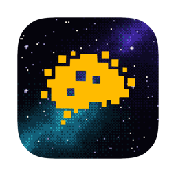
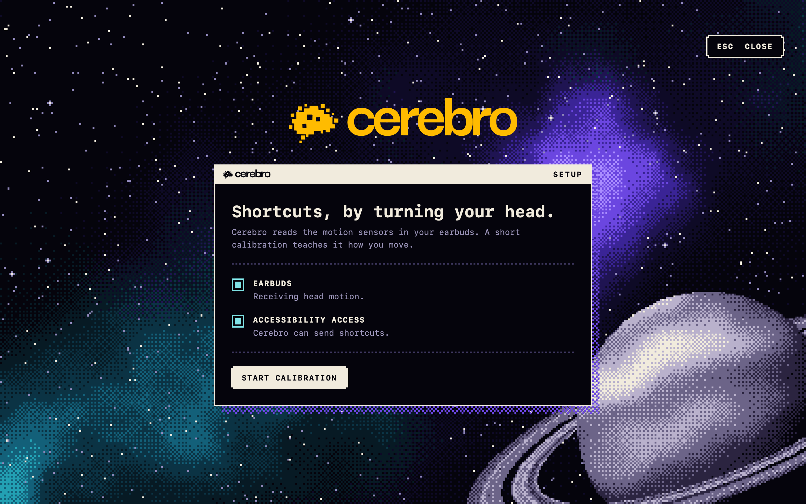
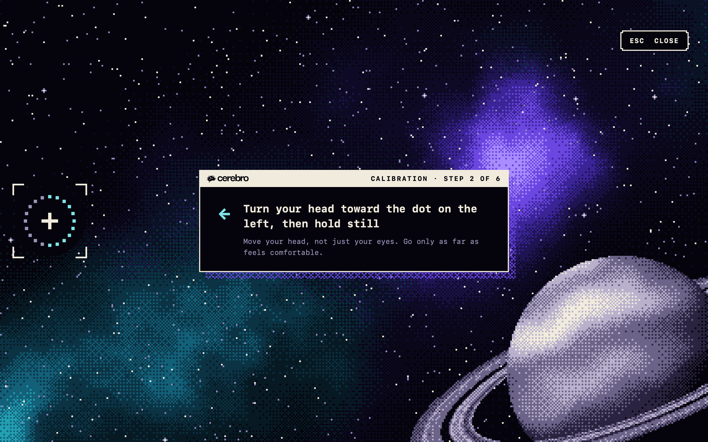
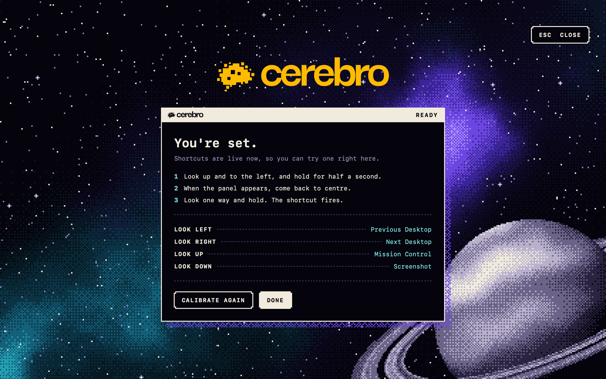
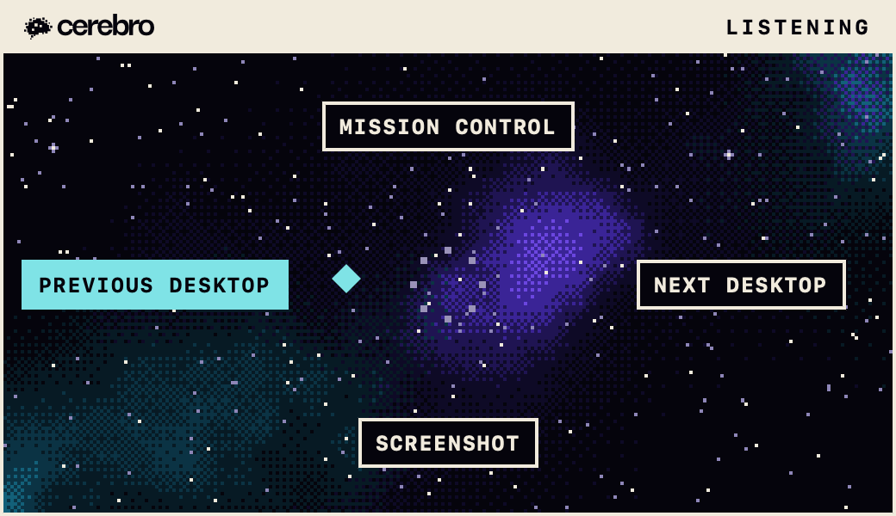

# Cerebro

Run shortcuts on your Mac by turning your head. Cerebro reads the motion sensors in the earbuds you already wear, so a look to one side can switch desktops, open Mission Control or take a screenshot. Everything runs on your Mac.



> [!WARNING]
> **Early version.** Cerebro has been built and tested on one Mac with one pair of Powerbeats Pro 2. Gestures can be missed, or fire when you didn't mean them, and other earbuds are untested.

| Calibrate | Ready | Listening |
| --- | --- | --- |
|  |  |  |

## The idea

Cerebro began as a play on accessibility. Controlling a computer without your hands has usually meant dedicated hardware: head pointers, switches, eye trackers. Meanwhile, the earbuds many people already wear carry motion sensors good enough to follow a turn of the head. As software improves, it can bridge some of the gaps that hardware used to fill. Cerebro is an experiment in how far that goes.

It is a sibling to [Touchwood](https://github.com/theroofkashyap/touchwood), which tries the same idea with sound: it turns spots on your desk into buttons using the Mac's microphone.

Cerebro has not been tested with people who rely on assistive technology, so read the accessibility angle as where the idea came from, not as a claim about what it does today.

## What it's for

The use cases are still being explored. Today it is used as:

- **A productivity device:** head shortcuts for things like switching desktops and taking screenshots.
- **A mouse:** an optional mode moves the cursor with your head.

Gaming has some use cases too, and more are being explored.

## How it works

1. **Calibrate.** Look at a dot in the centre of the screen, then at dots on the left, right, top and bottom, then up and to the left with your chin lifted. This teaches Cerebro how far you turn. The last pose becomes your activation gesture.
2. **Activate.** Hold the activation pose for half a second. A small panel appears, showing what each direction does.
3. **Come back to centre** within three seconds.
4. **Look one way and hold.** After about half a second the shortcut fires. If you choose nothing within six seconds, the panel goes away.

Nothing happens until you activate, so ordinary head movement is ignored.

These are the default shortcuts. Change them under **Shortcuts** in the menu bar menu.

| Look | Shortcut |
| --- | --- |
| Left | Previous Desktop (⌃←) |
| Right | Next Desktop (⌃→) |
| Up | Mission Control (⌃↑) |
| Down | Screenshot (⇧⌘3) |

The other choices are Approve (Return), Cancel (Esc) and Nothing.

**⌃⌥M** pauses and resumes tracking.

### Head cursor

This mode is off by default. Turn on **Head Cursor → Move Cursor With Head** in the menu and the cursor follows your head. Pushing it into a screen edge re-centres you, like lifting a mouse.

While it is on, Cerebro takes over the earbuds' play/pause button for clicking: one press to click, two for a right click, three to pause tracking. This mode is rougher than the shortcuts. The cursor is coarse, and the button clicks have not been verified on real earbuds.

## Requirements

- macOS 14 or later.
- Earbuds or headphones that support head tracking on a Mac. Cerebro was built with Powerbeats Pro 2. AirPods with head-tracked spatial audio should work, but are untested.
- The earbuds in your ears and connected to the Mac. Motion only flows while they are worn.

## Install

There is no download yet; you build it from source. You need Apple's Swift compiler (Xcode, or the Command Line Tools from `xcode-select --install`).

```sh
git clone https://github.com/theroofkashyap/cerebro.git
cd cerebro
sh build.sh
open build/Cerebro.app
```

Cerebro lives in the menu bar. The first launch opens the welcome screen, and macOS asks for two permissions:

- **Motion**, to read head movement from the earbuds.
- **Accessibility**, to send the shortcut keystrokes, and to move the cursor in head cursor mode. Switch Cerebro on under System Settings → Privacy & Security → Accessibility.

The build is ad-hoc signed with a fixed requirement, so the Accessibility permission survives rebuilds. The bundle identifier, `local.mousie`, is the project's working name from before it was called Cerebro.

The logo files are not part of this repository. Built from here, the app shows a plain text title and a system menu bar icon in place of the logo in the screengrabs.

## Privacy

Everything runs on your Mac and nothing is sent anywhere; the app makes no network connections. It stores only your calibration and settings, in macOS preferences.

## Development

```sh
sh test.sh
```

This runs the gesture and calibration logic against simulated head motion, with no earbuds needed.

To check that keystrokes get through without wearing earbuds, send the running app a signal and it fires the Look Down shortcut:

```sh
kill -USR1 "$(pgrep -x Cerebro)"
```

## License

MIT. See [LICENSE](LICENSE).
